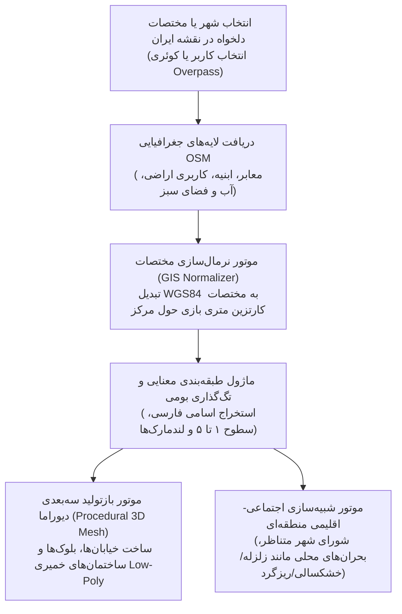
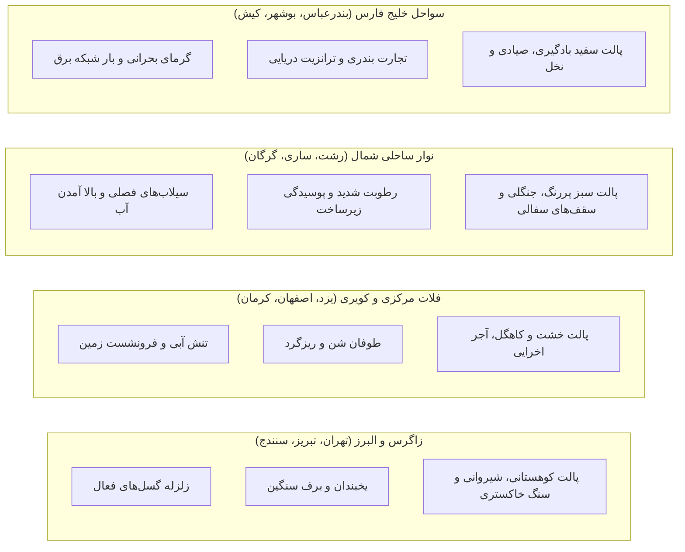

# سند معماری موتور استخراج و ترجمه نقشه کل شهرهای ایران (Universal Iran City Engine)

این سند، معماری بازطراحی‌شده و ماژولار بازی را تشریح می‌کند تا موتور بازی از وابستگی به یک شهر خاص (پایلوت گلبهار) رها شده و بتواند نقشه، خیابان‌ها، کاربری‌ها و اقلیم **هر نقطه‌ای از ایران** (تهران، مشهد، اصفهان، شیراز، تبریز، یزد، کیش، رشت، اهواز و ...) را به صورت پویا و خودکار از داده‌های جغرافیایی استخراج و وارد دنیای بازی کند.

---

## ۱. چرخه انتقال از تک‌شهری به معماری چندشهری (Generalization Architecture)

---

## ۲. لایه‌های فنی پایپ‌لاین تبدیل نقشه (Map Translation Pipeline)

### لایه ۱: استخراج داده‌های مکانی (Overpass API / GeoJSON Ingestion)
به جای دیتای ایستا، موتور یک کوئری استاندارد Overpass بر اساس کادر جغرافیایی (Bounding Box) دریافت می‌کند:
* **معابر (`highway`):** دسته‌بندی خودکار از آزادراه (Motorway) تا کوچه (Residential/Alley).
* **ساختمان‌ها (`building` و `amenity`):** استخراج مساحت، ارتفاع (`building:levels`)، نوع کاربری و نام ثبت‌شده فارسی.
* **پهنه‌های طبیعی (`natural`, `water`, `leisure`):** دریاچه‌ها، رودخانه‌ها، پارک‌ها و اراضی کشاورزی.

### لایه ۲: تبدیل دستگاه مختصات (Projection & Scaling Math)
مختصات جغرافیایی به دستگاه دکارتی بازی تبدیل می‌شود:
$$\Delta X = (\text{lon} - \text{centerLon}) \times 111320 \times \cos(\text{centerLat})$$
$$\Delta Z = (\text{centerLat} - \text{lat}) \times 111320$$

* الگوریتم **Ramer-Douglas-Peucker (RDP)** برای ساده‌سازی نقاط متوالی معابر استفاده می‌شود تا تعداد رئوس معابر بدون از دست رفتن فرم منحنی‌ها تا ۷۰٪ کاهش یابد و نرخ فریم روی ۶۰ قفل بماند.

### لایه ۳: قوانین طبقه‌بندی و ارتقای ۵ سطحی در شهرهای ایران

| تگ‌های OSM | رده در بازی | نام پیش‌فرض فارسی | سطح اولیه | ظرفیت ارتقا (۱ تا ۵) |
| :--- | :--- | :--- | :---: | :--- |
| `building=residential, apartments` | مسکونی / آپارتمان | آپارتمان / مسکن ملی | ۱ تا ۳ بر اساس `building:levels` | خانه ویلایی ⬅️ آپارتمان ۴ طبقه ⬅️ برج مدرن |
| `building=retail, shop, commercial` | تجاری | راسته بازار / پاساژ | ۲ | مغازه محلی ⬅️ پاساژ تجاری ⬅️ مگامال |
| `building=civic, townhall, government` | حکمرانی | شهرداری و شورای شهر | ۳ | ساختمان ناحیه ⬅️ عمارت مرکزی شهرداری |
| `amenity=police, fire_station, hospital` | خدمات شهری | کلانتری / آتش‌نشانی / بیمارستان | ۲ | پایگاه امدادی ⬅️ ایستگاه مجهز مرکزی |
| `historic=*, tourism=attraction` | لندمارک شاخص | بنای تاریخی / توریستی | ۴ | بنای حفظ‌شده با بلیت‌فروشی گردشگری |

---

## ۳. سیستم هوشمند اقلیم و بحران‌های بومی بر اساس جغرافیای ایران

هر شهر به تناسب موقعیت مکانی در فلات ایران، پروفایل بحران و پالت رنگی مختص خود را بارگذاری می‌کند:

---

## ۴. برنامه پیاده‌سازی گام‌به‌گام (Milestones)

1. **مرحله ۱ (جداسازی دیتای ایستا):**
   * تبدیل آرایه‌های هاردکد گلبهار در `Web_Prototype` به شیء پیکربندی پذیرنده `city_data.json`.
2. **مرحله ۲ (ماژول پارسر چندشهری تحت وب):**
   * افزودن یک منوی کشویی یا نقشه انتخاب استان/شهر (تهران، اصفهان، شیراز، مشهد، گلبهار) در منوی اولیه بازی.
   * ایجاد کش از شهرهای شاخص جهت اجرای آفلاین بدون وابستگی لحظه‌ای به اینترنت.
3. **مرحله ۳ (ارتباط لوایح شورا با مطالبات محلی):**
   * در شهرهای کویری، لوایح شورا معطوف به حفر قنات و انتقال آب باشد؛ در شهرهای شمالی، زهکشی معابر و مهار سیلاب.
